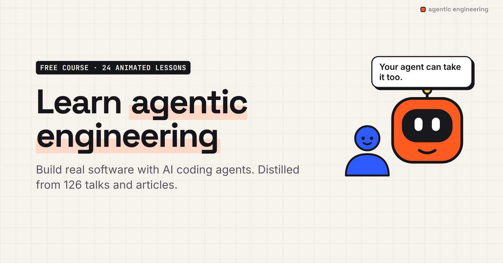

<p align="center"><a href="https://learn-agentic-engineering.pages.dev"></a></p>

<h1 align="center">Agentic Engineering</h1>
<p align="center"><b>A free, animated course on building real software with AI coding agents.</b><br>
Claude Code · Codex · Cursor · Copilot · Amp · any agent.<br>
24 short lessons · ~98 minutes · distilled from 82 talks and 44 articles · every claim linked to its source.</p>

<p align="center">
<a href="https://learn-agentic-engineering.pages.dev/lessons/vibe-coding-to-agentic-engineering/"><b>▶ Start lesson 1</b></a> ·
<a href="#lessons">All lessons</a> ·
<a href="#your-agent-can-take-this-course-too">For your agent</a> ·
<a href="https://learn-agentic-engineering.pages.dev/sources/">Sources</a> ·
<a href="https://learn-agentic-engineering.pages.dev/llms.txt">llms.txt</a>
</p>

---

**Agentic engineering** is Andrej Karpathy's name for the professional version of vibe coding: agents write and run the code, and you keep the quality bar. Since late 2025 coding agents do what you ask almost every time, and the people who build them now ship most of their code this way. This course teaches the workflow they actually use.

It's built from the talks, interviews and essays of people like Andrej Karpathy, Boris Cherny, Simon Willison, Kent Beck, Mitchell Hashimoto, Martin Fowler, Dex Horthy, Matt Pocock, Thorsten Ball, Cat Wu, Thariq Shihipar, Ryan Lopopolo, Peter Steinberger, Armin Ronacher, Geoffrey Huntley, Hamel Husain, Shreya Shankar, Charity Majors, DHH, Lauren Tan, Barry Zhang, Addy Osmani, Andrew Ng, Steve Yegge, Clare Liguori, Daisy Hollman, Mario Zechner and Theo Browne. Not affiliated with or endorsed by any of them.

## What you'll learn

- **How agents work** — the loop, tool calls, context windows, and why agents are jagged geniuses
- **The core workflow** — explore → plan → implement → verify, specs, prompting, and closing the loop with real checks
- **Your toolkit** — AGENTS.md / CLAUDE.md memory files, CLIs vs MCP, skills, commands, hooks, git as a safety net
- **Scaling up** — subagents, parallel agents with worktrees, Ralph loops and long-running agents, harness engineering
- **Quality, safety, teams** — agent-friendly codebases, evals, prompt injection and the lethal trifecta, team adoption
- **The engineer you become** — which skills lose value, which compound, and what comes next

Each lesson is a 3–5 minute animated video, a full transcript, a quiz, a hands-on "try it with your agent" prompt, and cited sources.

## Your agent can take this course too

The course ships as **agent skills**, so your coding agent follows the same practices you learn:

```bash
npx skills add Haple/agentic-engineering
```

Or in Claude Code, as a plugin marketplace:

```text
/plugin marketplace add Haple/agentic-engineering
/plugin install agentic-engineering@agentic-engineering
```

| Skill | What it does |
|---|---|
| [`agentic-engineering`](skills/agentic-engineering/SKILL.md) | Working practices for any non-trivial coding task: explore before editing, plan in verifiable slices, verify with real checks, keep context clean, stay safe. |
| [`agentic-engineering-tutor`](skills/agentic-engineering-tutor/SKILL.md) | Teaches you the course inside your agent: *"teach me lesson 4"*, *"quiz me on evals"*, *"next lesson"*. |
| [`agentic-engineering-audit`](skills/agentic-engineering-audit/SKILL.md) | Audits your repo's agent setup (memory files, feedback loops, skills, hooks, security) and fixes the top gaps. |

Agents can also read the whole course directly: [`/llms.txt`](https://learn-agentic-engineering.pages.dev/llms.txt) · [`/llms-full.txt`](https://learn-agentic-engineering.pages.dev/llms-full.txt) · [`/api/course.json`](https://learn-agentic-engineering.pages.dev/api/course.json) · or any lesson in [`lessons/`](lessons/).

## Lessons

### Module 1 · The shift

What changed, and how a coding agent actually works.

| # | Lesson | Watch | Read | Length |
|---|---|---|---|---|
| 01 | **From vibe coding to agentic engineering** | [▶ watch](https://learn-agentic-engineering.pages.dev/lessons/vibe-coding-to-agentic-engineering/) | [markdown](lessons/01-vibe-coding-to-agentic-engineering.md) | 4 min |
| 02 | **How a coding agent actually works** | [▶ watch](https://learn-agentic-engineering.pages.dev/lessons/how-coding-agents-work/) | [markdown](lessons/02-how-coding-agents-work.md) | 4 min |
| 03 | **What agents are great at, and where they fail** | [▶ watch](https://learn-agentic-engineering.pages.dev/lessons/what-agents-are-good-at/) | [markdown](lessons/03-what-agents-are-good-at.md) | 4 min |

### Module 2 · Working with one agent

The core workflow that every other technique builds on.

| # | Lesson | Watch | Read | Length |
|---|---|---|---|---|
| 04 | **Context is everything** | [▶ watch](https://learn-agentic-engineering.pages.dev/lessons/context-engineering/) | [markdown](lessons/04-context-engineering.md) | 4 min |
| 05 | **The core loop: explore, plan, implement, verify** | [▶ watch](https://learn-agentic-engineering.pages.dev/lessons/explore-plan-implement-verify/) | [markdown](lessons/05-explore-plan-implement-verify.md) | 4 min |
| 06 | **Specs agents can execute** | [▶ watch](https://learn-agentic-engineering.pages.dev/lessons/writing-specs-for-agents/) | [markdown](lessons/06-writing-specs-for-agents.md) | 4 min |
| 07 | **Talking to agents** | [▶ watch](https://learn-agentic-engineering.pages.dev/lessons/prompting-coding-agents/) | [markdown](lessons/07-prompting-coding-agents.md) | 4 min |
| 08 | **Close the loop: let agents check their work** | [▶ watch](https://learn-agentic-engineering.pages.dev/lessons/verification-closing-the-loop/) | [markdown](lessons/08-verification-closing-the-loop.md) | 4 min |
| 09 | **Reviewing agent code** | [▶ watch](https://learn-agentic-engineering.pages.dev/lessons/reviewing-agent-code/) | [markdown](lessons/09-reviewing-agent-code.md) | 4 min |
| 10 | **When the agent goes off the rails** | [▶ watch](https://learn-agentic-engineering.pages.dev/lessons/when-agents-go-wrong/) | [markdown](lessons/10-when-agents-go-wrong.md) | 4 min |

### Module 3 · Your toolkit

Memory files, tools, skills, hooks and git.

| # | Lesson | Watch | Read | Length |
|---|---|---|---|---|
| 11 | **CLAUDE.md and AGENTS.md: memory files that work** | [▶ watch](https://learn-agentic-engineering.pages.dev/lessons/claude-md-agents-md-memory-files/) | [markdown](lessons/11-claude-md-agents-md-memory-files.md) | 4 min |
| 12 | **Tools, CLIs and MCP** | [▶ watch](https://learn-agentic-engineering.pages.dev/lessons/tools-clis-and-mcp/) | [markdown](lessons/12-tools-clis-and-mcp.md) | 4 min |
| 13 | **Skills, commands and hooks** | [▶ watch](https://learn-agentic-engineering.pages.dev/lessons/skills-commands-hooks/) | [markdown](lessons/13-skills-commands-hooks.md) | 4 min |
| 14 | **Git is your safety net** | [▶ watch](https://learn-agentic-engineering.pages.dev/lessons/git-for-coding-agents/) | [markdown](lessons/14-git-for-coding-agents.md) | 4 min |

### Module 4 · Scaling up

Subagents, parallel agents, long runs and harness engineering.

| # | Lesson | Watch | Read | Length |
|---|---|---|---|---|
| 15 | **Subagents: delegate to a fresh context** | [▶ watch](https://learn-agentic-engineering.pages.dev/lessons/subagents/) | [markdown](lessons/15-subagents.md) | 4 min |
| 16 | **Running agents in parallel** | [▶ watch](https://learn-agentic-engineering.pages.dev/lessons/parallel-agents-worktrees/) | [markdown](lessons/16-parallel-agents-worktrees.md) | 4 min |
| 17 | **Long-running agents and loops** | [▶ watch](https://learn-agentic-engineering.pages.dev/lessons/long-running-agents-ralph-loop/) | [markdown](lessons/17-long-running-agents-ralph-loop.md) | 4 min |
| 18 | **Harness engineering: build the factory** | [▶ watch](https://learn-agentic-engineering.pages.dev/lessons/harness-engineering/) | [markdown](lessons/18-harness-engineering.md) | 4 min |

### Module 5 · Quality, safety, teams

Keep the bar high when code is cheap.

| # | Lesson | Watch | Read | Length |
|---|---|---|---|---|
| 19 | **Codebases agents can work in** | [▶ watch](https://learn-agentic-engineering.pages.dev/lessons/agent-friendly-codebases/) | [markdown](lessons/19-agent-friendly-codebases.md) | 5 min |
| 20 | **Evals: measure, don't vibe** | [▶ watch](https://learn-agentic-engineering.pages.dev/lessons/evals-for-agents/) | [markdown](lessons/20-evals-for-agents.md) | 4 min |
| 21 | **Security: prompt injection and the lethal trifecta** | [▶ watch](https://learn-agentic-engineering.pages.dev/lessons/prompt-injection-lethal-trifecta/) | [markdown](lessons/21-prompt-injection-lethal-trifecta.md) | 4 min |
| 22 | **Agentic engineering in teams** | [▶ watch](https://learn-agentic-engineering.pages.dev/lessons/agentic-engineering-in-teams/) | [markdown](lessons/22-agentic-engineering-in-teams.md) | 4 min |

### Module 6 · The engineer you become

Your role, your skills, and what comes next.

| # | Lesson | Watch | Read | Length |
|---|---|---|---|---|
| 23 | **The engineer you become** | [▶ watch](https://learn-agentic-engineering.pages.dev/lessons/the-engineer-you-become/) | [markdown](lessons/23-the-engineer-you-become.md) | 4 min |
| 24 | **What comes next** | [▶ watch](https://learn-agentic-engineering.pages.dev/lessons/what-comes-next/) | [markdown](lessons/24-what-comes-next.md) | 4 min |

## How it was made

A course about building with agents, built with agents:

1. **Sources.** 82 talks and interviews (transcripts) and 44 written guides on agentic coding from 2025–2026.
2. **Distillation.** A model extracted ~3,000 specific, citable insights, each with a verbatim quote and timestamp, automatically checked against the transcript.
3. **Writing.** Lessons were written from those insights by Claude, with every source attached; claims and numbers were checked against the source text.
4. **Animation.** The lessons are **not video files**. Each is a JSON list of scenes (terminals, diffs, diagrams, charts, quizzes) rendered live by a small GSAP engine ([`site/static/js`](site/static/js)) and synced word-by-word to an AI voice. That makes them tiny, crisp at any size, scrubbable, and responsive: 16:9 on desktop, 9:16 on phones.

Found a mistake? [Open an issue](https://github.com/Haple/agentic-engineering/issues) with the lesson and timestamp. Every claim links to its source, so corrections are easy to check.

## Run it locally

```bash
node site/build.mjs          # builds site/dist from course/ + site/static/data
cd site/dist && python3 -m http.server 8000
```

Narration audio isn't stored in git; regenerate it with `tools/voice.mjs` (needs a fal.ai key) or use the hosted site.

## License

Course content: [CC BY 4.0](https://creativecommons.org/licenses/by/4.0/). Code: MIT. Quotes belong to their speakers and link to the original talks.

If this helped you, ⭐ the repo and share it with a teammate. That's how free courses find people.
